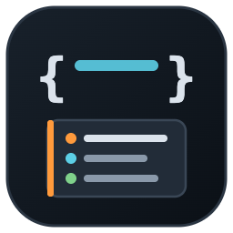
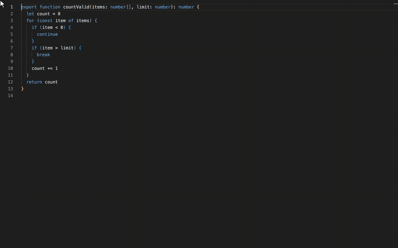
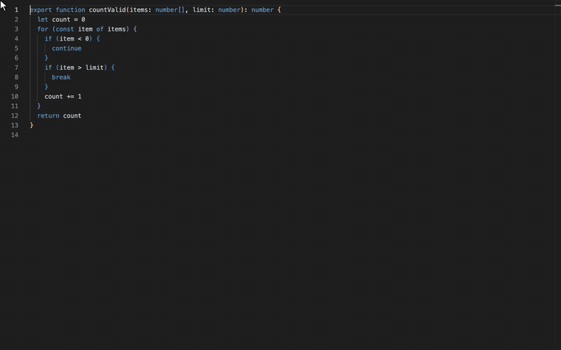
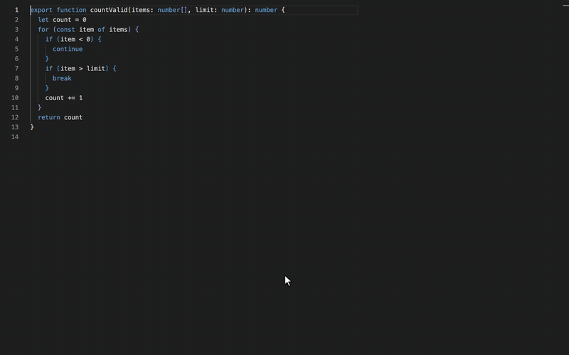

<p align="center"></p>

<h1 align="center">Code Explainer</h1>

<p align="center">Agentic code explainer for Orca<br>
a quick <b>overview</b>, a piece-by-piece <b>breakdown</b>, a <b>call hierarchy</b>, or an <b>interactive flowchart</b> you step through.</p>


Code Explainer is a plugin for [Orca](https://github.com/stablyai/orca). It adds a code editor with a selection menu. Highlight code and pick one of four actions. The answer appears in a pane beside your code, written by the agent you already use (Claude Code or Codex). The agent can read the rest of your project to give context, but it can't change anything.

## The four actions

Highlight code. Four stacked buttons appear under the selection, and the same four are in the right-click menu:


### Explain: what is this for? (`⌘⇧E`)

A short, high-level overview, with no line-by-line walkthrough. It opens with a one-line **In short**, then:

- **What it's for:** the problem the code solves.
- **Where it fits:** who calls or uses it and what it relies on, with file paths.
- **Inputs and outputs:** what goes in, what comes out, and any side effects.
- **Ask next:** three follow-up questions you can click to ask.



### ≡ Break it down: how does each piece work? (`⌘⌥B`)

One level deeper than Explain. It takes the selection apart statement by statement, then splits each statement into its expressions, operators and calls, in the order they run. It's all text: no flowchart and nothing interactive. It opens with **In short**, then:

- **Breakdown diagram:** a text tree of the code. Each statement sits under its block, and each part under its statement, with its line and a short `←` note. Numbered chunks (`[1]`, `[2]`, …) point to the steps below.
- **Step by step:** one item per numbered chunk. It covers what each operator and call does (precedence, short-circuiting, type coercion, mutation) and why it's there.
- **Putting it together:** how the chunks combine, what comes out, and any side effects.
- **Watch out for:** only when an operator or statement hides a real trap.

```text
percent(part, whole)                         :1   ← percentage of part in whole
├─ [1] if (whole === 0) return 0             :2   ← guard before dividing
│     ├─ whole === 0                              ← strict equality: no type coercion
│     └─ return 0                                 ← leaves early; nothing below runs
└─ [2] return Math.min(Math.round(…), 100)   :3   ← the result
      ├─ part / whole * 100                       ← / then *, left to right
      ├─ Math.round(…)                            ← to the nearest whole number
      └─ Math.min(…, 100)                         ← caps it at 100
```

After any answer, the **Show the breakdown diagram** suggestion draws just the diagram for the code you last asked about.



### ⑂ Call hierarchy: how does it connect? (`⌘⌥H`)

A text call tree from the entry point that reaches your selection down to everything it calls. Each call is indented under its caller, with the file name where a call crosses files and a short `←` note on what each step does. The agent reads the called code first so the names are real, and marks anything it couldn't confirm with `(?)`.

```text
(?) caller not found      ← nothing in the project calls countValid
   └─ countValid(items, limit)   src/total.ts:1
         └─ for (const item of items)   ← :3, goes through items in order
               ├─ item < 0  → continue   ← :4, skips negative values
               ├─ item > limit → break   ← :7, stops the whole loop
               └─ count += 1             ← :10, counts the accepted item
         └─ return count                 ← :12
```



### ▶ Interactive: how does it run, step by step? (`⌘⌥I`)

A flowchart of the selected code that you step through like a debugger, without running anything:

- **◀ Prev / Next ▶** (or the arrow keys) move through the steps in execution order.
- **State buttons** jump between the situations worth comparing, such as `iteration 1: item 2`, `iteration 2: item -1` (where `continue` fires) or `iteration 3: item 7` (where `break` fires).
- At each step, the active boxes light up, a note says **why** it happens, a table shows the **variable values** (changed values highlighted), and the matching **lines light up in your editor**.


| Step through the loop | Jump to a state |
| --- | --- |
|  |  |

### Which one should I use?

| | Explain | Break it down | Call hierarchy | Interactive |
| --- | --- | --- | --- | --- |
| **Answers** | What is this for, and where does it fit? | What does each statement and operator do? | What does this call, and what calls it? | How does it actually run, case by case? |
| **Shape** | Short sections: purpose, context, inputs/outputs | Breakdown tree, then numbered steps | Indented text tree with file and line notes | Flowchart with steps, states, variables and editor highlights |
| **Depth** | High level, no line-by-line | Every statement, expression and operator, in order | Structure across functions and files | Execution, one step at a time with example values |
| **Best for** | Unfamiliar code, a quick orientation | Dense expressions, unfamiliar syntax, close reading | Tracing callers and dependencies, refactoring | Loops, branches, early returns, state machines |
| **Shortcut** | `⌘⇧E` | `⌘⌥B` | `⌘⌥H` | `⌘⌥I` |

After any answer you can ask a follow-up, click a suggested question, stop the agent, or start a new conversation. Each workspace keeps its own conversation. To switch between Claude Code and Codex, pick one at the top of the pane: the two can't continue each other's conversations, so switching starts a new one.

## Install

**From Orca's plugin directory:** search for *Code Explainer*, or open `orca://plugins/orvillelim.code-explainer?catalog=community`. Orca shows what the plugin can access before you approve it; see [Privacy and safety](#privacy-and-safety).

**From GitHub**, pinned to the newest release (add `@v1.0.2` to pick one):

```sh
orca plugin install orvillelim/orca-code-explainer                         # shows its access, prints a fingerprint
orca plugin install orvillelim/orca-code-explainer --approve <fingerprint>
```

**From a local copy**, such as one you've changed:

```sh
git clone https://github.com/orvillelim/orca-code-explainer.git
cd orca-code-explainer
npm install
npm run reinstall    # builds, shows its access, installs once you answer y
```

Run `npm run reinstall` again after each change; it replaces the installed copy. Don't use `orca plugin install .` in this folder: Orca refuses the symlinks that `npm install` puts in `node_modules`, so the script installs a clean copy of the plugin's files instead.

You need Orca 1.4.256 or newer, and the [Claude Code](https://docs.anthropic.com/en/docs/claude-code) or [Codex](https://github.com/openai/codex) CLI installed and signed in.

In Settings → Plugins → Code Explainer you choose:

- **Agent:** Claude Code or Codex, for new conversations.
- **Model and effort**, for each agent, from a list. The default leaves the CLI's own choice. Claude Code's models (Fable, Opus, Sonnet, Haiku) are always their latest version. Codex's list is its models when this version of the plugin came out, so a newer one needs a plugin update. Changes apply from the next question.
- **Surrounding lines:** how many lines above and below the selection are sent with it.

## Opening files in Code Explainer

- These open in Code Explainer by default: `.py`, `.go`, `.rs`, `.java`, `.c`, `.rb` and other code files, plus Godot files (`.gd`, `.gdshader`, `.tscn`, `.tres`). Godot files use the same grammars as Orca's Godot plugin.
- For the types Orca opens itself (`.ts`, `.js`, `.json`, `.md`, `.yaml`, …), click **Code Explainer** beside **Source** at the top of the editor tab. Orca doesn't let plugins take those over.
- Code Explainer is for reading and explaining code. It highlights every language and you can edit and save, but it has no smart completions, hover or go to definition. Switch to **Source** for those.
- To go back to Orca's editor everywhere, turn the plugin off in Settings → Plugins.

## Zoom

The editor and the pane zoom separately.

- **⌘⌥= / ⌘⌥- / ⌘⌥0** zoom whichever side has focus.
- **⌘ + scroll** (or pinch) zooms the side under the pointer.
- **− 100% +** in the pane zooms the pane.

Plain ⌘= / ⌘- don't reach plugins on Orca 1.4.256. Newer Orca versions pass their editor zoom to the plugin automatically.

## Privacy and safety

- **Your code goes only to your agent.** The selection and the files the agent asks to read are sent to the agent you chose (Claude Code or Codex), under your own account. The plugin has no analytics or tracking.
- **The agent can't edit anything or run commands.** Its own file, shell and web tools are turned off. Its only tools are three read-only ones: list, read and search files inside the open project folder. They refuse paths outside the project, binary files, very large files, and secret or key files (`.env`, `*.pem`, `*.key`, …).
- **The interactive diagram is data, not code.** The agent writes it as JSON. The plugin validates it and draws it with Mermaid in strict mode, using Orca's own sanitizer.

Local workspaces only: projects on SSH hosts aren't supported yet.

### What runs

- **Your agent's CLI**, `claude` or `codex`, from your `PATH` (or `~/.local/bin`, `/opt/homebrew/bin`, `/usr/local/bin`). It starts for each question, signs in with your own login, and exits when the answer is done.
  - Its own file, shell and web tools are off. Its only tools are the plugin's three read-only ones: list, read and search project files.
  - It runs in an empty folder (`~/Library/Caches/orca-code-explainer/agents/…` on macOS), not in your project. It doesn't load your CLI settings, hooks or other MCP servers; your sign-in still works. That's also why it uses the model and effort from the plugin's settings, not the ones set in your CLI.
- **A local MCP server, `code_explainer`**, inside the plugin's own process. It's how the agent reads your project.
  - It listens on `127.0.0.1` only, on a random port, so other computers can't reach it.
  - It has three read-only tools: `list_project_files`, `read_project_file` and `search_project_code`.
  - The agent gets it for one answer at a time, when the plugin starts the CLI. It's never added to your Claude Code or Codex MCP settings.
  - Each answer gets a new random token that opens only its own project, and the token is revoked when the answer ends. Requests without it are refused.

### What it reads

- **The open file's location.** Orca doesn't tell plugins the file's path, so the plugin looks through your local workspaces, the focused one first, for the file with the same text. It only opens files of the right size, and the comparison happens on your computer.
- **Project instructions:** `CLAUDE.md` for Claude Code or `AGENTS.md` for Codex, from the project root and the folders down to the selected file. At the root it falls back to the other file when yours is missing.
- **Files the agent asks for**, through the file server, inside that project only.

### What leaves your computer

Only what your agent sends to its provider (Anthropic or OpenAI) under your account: your selection with the lines around it (20 above and below by default; Settings → Surrounding lines), the questions you type, the project instructions, and the files the agent reads. The plugin itself makes no internet requests.

### What it saves

- **Conversations**, in Orca's storage for the plugin: the last 30 messages of each workspace (about 15 questions and their answers), the agent session to resume, and which instruction files were already sent. **New conversation** clears them.
- **The agent's working folder**, one per workspace, in the cache folder above.
- Claude Code and Codex keep their own session history, as they always do. That's how a conversation continues from one question to the next.

Nothing is written to your project.

### What it never does

- Change your projects: neither the plugin nor the agent edits, creates or deletes files in them.
- Run anything besides your agent's CLI, and the agent itself can't run commands.
- Let the agent read outside the project folder (symlinks included), binary files, files over 1 MB, or files named like secrets.

## How it works

```
Orca editor tab ──text──► editor frame (Monaco, menu, pane)  ──request──►  worker (Node)
                                     ▲                                        │ spawns, tools off
                                     └──── streamed answer ◄── claude / codex ┘
                                                                   │ MCP (loopback, per-run token)
                                                                   ▼
                                                    read-only project reader
```

- **`src/editor/`:** the editor frame.
  - `main.ts` keeps Monaco in sync with Orca's document.
  - `selection-action.ts` is the menu.
  - `explain-pane.ts` and `answer-markdown.ts` render the conversation.
  - `walkthrough.ts` and `mermaid-runtime.ts` draw the interactive flowchart.
  - `editor-zoom.ts` handles zoom.
- **`src/explain-modes.mjs`:** the instructions for each of the four actions, in one place.
- **`worker/`:**
  - `main.mjs` handles conversations and finds the file by its content, since Orca doesn't give plugins the path.
  - `agent-cli.mjs` starts the CLIs with their tools turned off.
  - `workspace-mcp.mjs` and `project-reader.mjs` are the read-only file access.
  - `project-context.mjs` loads `CLAUDE.md` / `AGENTS.md`.
- **`vendor/orca/`:** a few MIT-licensed Orca source files reused as-is (language grammars, TextMate highlighter, Mermaid config, zoom steps). See `NOTICE.md`.

## Develop

```sh
npm install
npm run build        # bundles dist/ (npm run watch for unminified rebuilds)
npm run types        # writes Orca's plugin typings into .orca/
npm run typecheck
orca plugin dev load .   # loads this folder into Orca; rebuilds apply on their own
npm run reinstall    # builds and installs this folder as the copy Orca runs
```


## License

MIT, see `LICENSE`. This repository also includes MIT-licensed code from Orca and the Godot VS Code plugin, and bundles open-source npm packages. See `NOTICE.md`.
