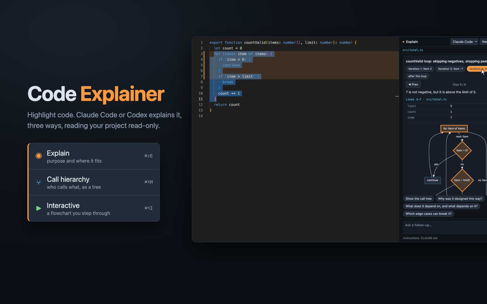
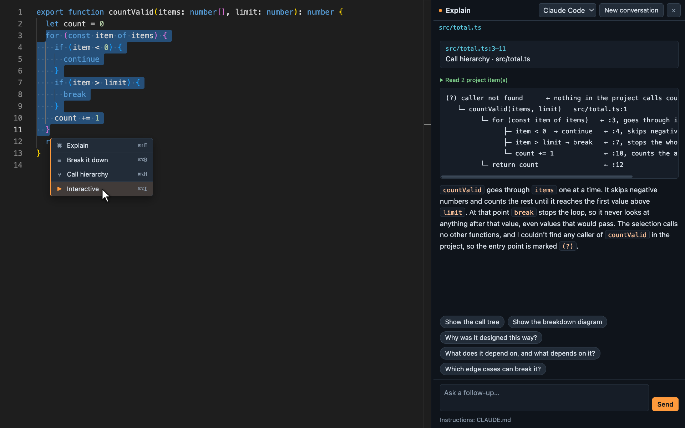
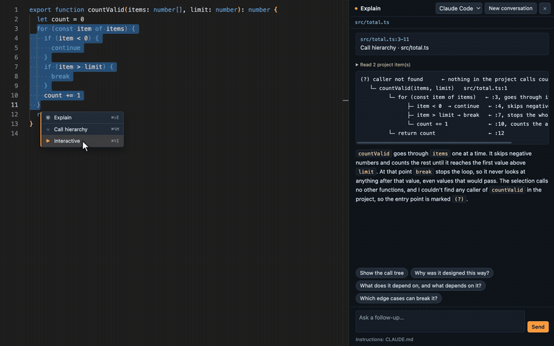
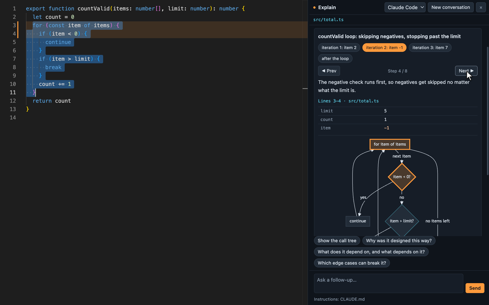
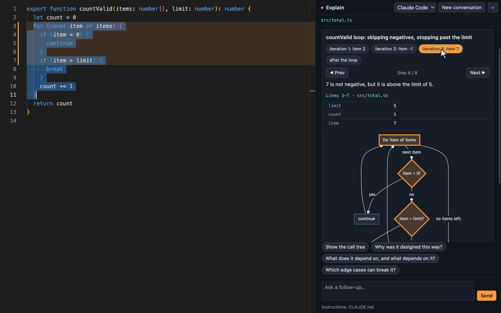

<p align="center"></p>

<h1 align="center">Code Explainer</h1>

<p align="center">Agentic code explainer for Orca<br>
a quick <b>overview</b>, a <b>call hierarchy</b>, or an <b>interactive flowchart</b> you step through.</p>



Code Explainer is a plugin for [Orca](https://github.com/stablyai/orca). It adds a code editor with a selection menu. Highlight code and pick one of three actions. The answer appears in a pane beside your code, written by the agent you already use (Claude Code or Codex). The agent can read the rest of your project to give context, but it can't change anything.

## The three actions

Highlight code. Three stacked buttons appear under the selection, and the same three are in the right-click menu:



### Explain: what is this for? (`⌘⇧E`)

A short, high-level overview, with no line-by-line walkthrough. It opens with a one-line **In short**, then:

- **What it's for:** the problem the code solves.
- **Where it fits:** who calls or uses it and what it relies on, with file paths.
- **Inputs and outputs:** what goes in, what comes out, and any side effects.
- **Ask next:** three follow-up questions you can click to ask.


### ⑂ Call hierarchy: how does it connect? (`⌘⌥H`)

A text call tree from the entry point that reaches your selection down to everything it calls. Each call is indented under its caller, with the file name where a call crosses files and a short `←` note on what each step does. The agent reads the called code first so the names are real, and marks anything it couldn't confirm with `(?)`.

```text
(?) caller not found      ← nothing in the project calls countValid
   └─ countValid(items, limit)   src/total.ts:1
         └─ for (const item of items)   ← :3, goes through items in order
               ├─ item < 0  → continue   ← :4, skips negative values
               ├─ item > limit → break   ← :7, stops the whole loop
               └─ count += 1             ← :10, counts the accepted item
         └─ return count                 ← :12
```


### ▶ Interactive: how does it run, step by step? (`⌘⌥I`)

A flowchart of the selected code that you step through like a debugger, without running anything:

- **◀ Prev / Next ▶** (or the arrow keys) move through the steps in execution order.
- **State buttons** jump between the situations worth comparing, such as `iteration 1: item 2`, `iteration 2: item -1` (where `continue` fires) or `iteration 3: item 7` (where `break` fires).
- At each step, the active boxes light up, a note says **why** it happens, a table shows the **variable values** (changed values highlighted), and the matching **lines light up in your editor**.



[Full-quality video (MP4)](media/videos/3-interactive.mp4)

| Step through the loop | Jump to a state |
| --- | --- |
|  |  |

### Which one should I use?

| | Explain | Call hierarchy | Interactive |
| --- | --- | --- | --- |
| **Answers** | What is this for, and where does it fit? | What does this call, and what calls it? | How does it actually run, case by case? |
| **Shape** | Short sections: purpose, context, inputs/outputs | Indented text tree with file and line notes | Flowchart with steps, states, variables and editor highlights |
| **Depth** | High level, no line-by-line | Structure across functions and files | Execution, one step at a time with example values |
| **Best for** | Unfamiliar code, a quick orientation | Tracing callers and dependencies, refactoring | Loops, branches, early returns, state machines |
| **Shortcut** | `⌘⇧E` | `⌘⌥H` | `⌘⌥I` |

After any answer you can ask a follow-up, click a suggested question, stop the agent, or start a new conversation. Each workspace keeps its own conversation.

## Install

**From Orca's plugin directory:** search for *Code Explainer*, or open `orca://plugins/orvillelim.code-explainer?catalog=community`. Orca shows what the plugin can access before you approve it.

**From source:**

```sh
git clone https://github.com/orvillelim/orca-code-explainer.git
orca plugin install ./orca-code-explainer       # prints a fingerprint
orca plugin install ./orca-code-explainer --approve <fingerprint>
```

You need Orca 1.4.256 or newer, and the [Claude Code](https://docs.anthropic.com/en/docs/claude-code) or [Codex](https://github.com/openai/codex) CLI installed and signed in. Settings → Plugins → Code Explainer chooses the agent and how many lines around the selection to send.

## Opening files in Code Explainer

- These open in Code Explainer by default: `.py`, `.go`, `.rs`, `.java`, `.c`, `.rb` and other code files, plus Godot files (`.gd`, `.gdshader`, `.tscn`, `.tres`). Godot files use the same grammars as Orca's Godot plugin.
- For the types Orca opens itself (`.ts`, `.js`, `.json`, `.md`, `.yaml`, …), click **Code Explainer** beside **Source** at the top of the editor tab. Orca doesn't let plugins take those over.
- To go back to Orca's editor everywhere, turn the plugin off in Settings → Plugins.

## Zoom

The editor and the pane zoom separately.

- **⌘⌥= / ⌘⌥- / ⌘⌥0** zoom whichever side has focus.
- **⌘ + scroll** (or pinch) zooms the side under the pointer.
- **− 100% +** in the pane zooms the pane.

Plain ⌘= / ⌘- don't reach plugins on Orca 1.4.256. Newer Orca versions pass their editor zoom to the plugin automatically.

## Privacy and safety

- **Your code goes only to your agent.** The selection and the files the agent asks to read are sent to the agent you chose (Claude Code or Codex), under your own account. The plugin has no analytics or tracking.
- **The agent can't edit anything or run commands.** Its own file, shell and web tools are turned off. Its only tools are three read-only ones: list, read and search files inside the open project folder. They refuse paths outside the project, binary files, very large files, and secret or key files (`.env`, `*.pem`, `*.key`, …).
- **The interactive diagram is data, not code.** The agent writes it as JSON. The plugin validates it and draws it with Mermaid in strict mode, using Orca's own sanitizer.

Local workspaces only: projects on SSH hosts aren't supported yet.

## How it works

```
Orca editor tab ──text──► editor frame (Monaco, menu, pane)  ──request──►  worker (Node)
                                     ▲                                        │ spawns, tools off
                                     └──── streamed answer ◄── claude / codex ┘
                                                                   │ MCP (loopback, per-run token)
                                                                   ▼
                                                    read-only project reader
```

- **`src/editor/`:** the editor frame.
  - `main.ts` keeps Monaco in sync with Orca's document.
  - `selection-action.ts` is the menu.
  - `explain-pane.ts` and `answer-markdown.ts` render the conversation.
  - `walkthrough.ts` and `mermaid-runtime.ts` draw the interactive flowchart.
  - `editor-zoom.ts` handles zoom.
- **`src/explain-modes.mjs`:** the instructions for each of the three actions, in one place.
- **`worker/`:**
  - `main.mjs` handles conversations and finds the file by its content, since Orca doesn't give plugins the path.
  - `agent-cli.mjs` starts the CLIs with their tools turned off.
  - `workspace-mcp.mjs` and `project-reader.mjs` are the read-only file access.
  - `project-context.mjs` loads `CLAUDE.md` / `AGENTS.md`.
- **`vendor/orca/`:** a few MIT-licensed Orca source files reused as-is (language grammars, TextMate highlighter, Mermaid config, zoom steps). See `NOTICE.md`.

## Develop

```sh
npm install
npm run build        # bundles dist/ (npm run watch for unminified rebuilds)
npm run types        # writes Orca's plugin typings into .orca/
npm run typecheck
orca plugin dev load .   # loads this folder into Orca; rebuilds apply on their own
```


## Publish a release

1. Bump `version` in `orca-plugin.json` (and `package.json`), run `npm run build`, then commit.
2. Run `orca plugin validate .`, then `orca plugin release-entry .` to print the pinned commit and content hash.
3. Tag the release and push the tag: `git tag -a v1.0.0 -m v1.0.0 && git push origin v1.0.0`.
4. For the first release only, add the `orca-plugin` topic: `gh repo edit orvillelim/orca-code-explainer --add-topic orca-plugin`.
5. Check the listing at `https://orca.dev/plugins/orvillelim/orca-code-explainer`.

## License

MIT, see `LICENSE`. This repository also includes MIT-licensed code from Orca and the Godot VS Code plugin, and bundles open-source npm packages. See `NOTICE.md`.
